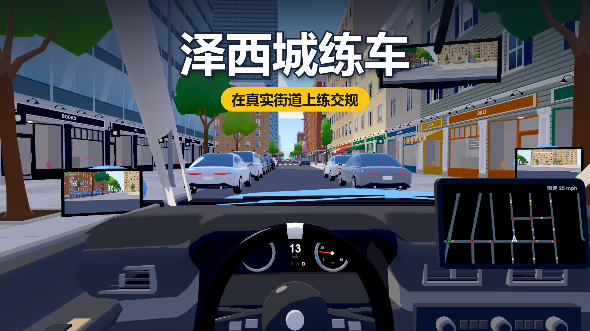

# 泽西城练车（Jersey Drive）



在线玩：<https://grrreymane.github.io/JerseyDrive/>

在 Jersey City 市中心的真实路网上练车、练交规的网页模拟器。three.js + OpenStreetMap 数据，不用打包。

## 运行

双击 `start.bat`，或者：

```bash
python -m http.server 8765
```

然后浏览器打开 <http://127.0.0.1:8765/>。必须走 http 服务，直接双击 `index.html` 打不开（ES module 限制）。

## 目录

| 路径 | 内容 |
|---|---|
| `src/sim/` | 纯逻辑，不碰 three / DOM，Node 里能直接跑：`map.js` 路网，`car.js` 车辆，`rules.js` 交规判定 |
| `src/view/` | 画面：`world.js` 场景，`geo.js` 建模工具，`models.js` 汽车 / 树 / 路灯等模型，`sky.js` 天空 / 阳光 / 阴影，`carview.js` 驾驶舱和镜头，`signs.js` 标志绘制，`audio.js` 声音 |
| `src/rulebook.js` | 所有讲解文案：违规解释、教练提示、标志图鉴 |
| `src/main.js` | 主循环、输入、界面 |
| `data/map.json` | 处理好的地图（由下面的脚本生成） |
| `tools/build_map.mjs` | 把 `tools/raw/osm.json` 处理成 `data/map.json` |
| `tools/test_rules.mjs` | 机器人开车过路口，检查交规判定 |

## 常用命令

```bash
npm run map     # 重新生成地图
npm test        # 跑交规判定测试
```

换区域：改 `tools/raw/query.txt` 和 `tools/build_map.mjs` 里的 `BBOX`，用 Overpass API 重新下载 `tools/raw/osm.json`，再 `npm run map`。

## 地图数据说明

- 路网、单行道、车道数、红绿灯位置、路面转向箭头来自 OpenStreetMap（© OpenStreetMap contributors，ODbL）。
- STOP 标志：OSM 里标了的按实际位置放；没标的无灯路口按道路等级推断（低等级让高等级，同级按全向停车），游戏里的提示会注明“推断”。
- 红绿灯相位是统一的两相位定时，不是真实配时。
- 限速：OSM 标了的用实际值，没标的按新泽西默认 25 mph。
- 高架、隧道（Holland Tunnel、Turnpike）暂时没做。

## 调试

地址后加 `?autostart` 跳过开始界面，`?cam=top` 俯视，`?seg=编号` 指定出生路段。控制台里 `__jd` 是调试钩子：

- `__jd.approach((j, l) => j.control === 'signal', 25)`：把车摆到某类路口前 25 米
- `__jd.overview(x, z, 高度)`：从正上方看地图
- `__jd.step(n, 输入)`：手动推进 n 步

## 美术验收（2026-11 程序化资产升级）

固定条件：画风 `cel`、1600×900、FOV 58°、`?q=0`（锁最高画质）。所有摆放都由编号哈希决定，每次打开一样。

| 用途 | 地址参数 |
|---|---|
| 驾驶舱验收视角 | `?style=cel&spot=cockpit&q=0` |
| 街景验收视角 | `?style=cel&spot=street&q=0` |
| 样板近景 | `spot=shop` / `stoop` / `tree` / `car`（可加 `n= d= side= eye= ty=`） |
| 白模（只看模型） | 任意视角加 `&clay` |
| 固定路线匀速开 | `?fly&v=8&len=260` |
| 跑分 | `?bench`，结果在 `window.__bench` |

```bash
node tools/cdp.mjs "http://127.0.0.1:8765/?style=cel&spot=street&q=0" --shot out.png
node tools/cdp.mjs "http://127.0.0.1:8765/?style=cel&bench&q=0" --nolimit --wait "window.__bench" --settle 0 --eval "window.__bench"
node tools/cdp.mjs "http://127.0.0.1:8765/?style=cel&fly&v=8&len=260&q=0" --video drive.webm --secs 24
```

截图在 `shots/`：`before/`、`after/`、`前后对照.png`、`样板.png`、`after/drive.webm`。

性能记录（同一台机器、同一路线 300 米、关垂直同步）：修改前 365 帧 / 845 次绘制 / 427 万面；修改后 191 帧 / 1183 次绘制 / 786 万面。

代码分工：`view/kit.js` 零件库（窗、店面、门、雨棚、招牌、台阶）；`view/buildings.js` 立面生成（开洞、分店面、檐口、远近切换）；`view/models.js` 车、树、路灯、消防栓；`view/carview.js` 驾驶舱。

### 第二轮（无描边）

默认画风改为 `city`：不描边、柔和三段明暗、天光半球补光、屏幕空间接触阴影、玻璃和车漆按视角反射天空。`?line=1` 或按 O 可以把描边开回来；`?style=cel&line=1` 是上一轮的效果。`&clay` 现在是普通漫反射灰（中性材质诊断）。

对照图在 `shots/r2/`：`描边开关对照.png`、`三联对照.png`（原效果 / 中性材质 / 调整后）、`drive.webm`。性能：同一路线 222 帧 / 1184 次绘制。

### 第三轮：车流、行人、大地图

- `src/sim/traffic.js`：别的车（等红灯、STOP 前停、让路口里的车和行人）和行人（沿人行道走，到斑马线过马路）。只在玩家周围生成。`?empty` 关掉。
- 新增判定：`no_yield`（没让有路权的车）、`no_yield_ped`、`hit_ped`、`hit_car`；教练会提前提示该让谁。
- 小地图并进了车内中控屏（车外视角仍显示右下角圆形小地图）。
- 地图范围扩到约 3.2 × 3.2 公里（130 公里路、8170 栋楼），建筑按距离分块加载 / 卸载（`buildings.js` 的 `ensure`）。
- 高架（新泽西收费公路纽瓦克湾支线）和隧道还没有：路网目前是平的，没有高度。
- 画风只留两套：赛璐璐、干净无描边（V 切换，O 开关描边）。
- `npm test` = 规则测试 + 车流自检。

### 第四轮：课程、大地图、碰撞演出

- `src/lessons.js`：十节课（起步停车 → STOP → 红绿灯 → 右转 → 左转 → 红灯右转 → 礼让行人 → 路口让车 → 主干道限速 → 综合路考）。每节课是“出发点 + 做对若干次的目标 + 不能犯的错”，星级按扣分算，存在 `localStorage.jdLessons`。`?lesson=3` 直接进第 3 课。
- M：大地图（上北下南，拖动、滚轮缩放）。
- 撞到车 / 人 / 路边的车：原地停 1.7 秒（四周泛红、闷响、行人倒地、被撞的车停住闪灯），再退回 9 米。
- 行人的腿和胳膊是单独的实例，走路时前后摆。
- 右后视镜在正前方视野之外：按 X 先对准右镜，按住再回头看右后方。
- 画风只剩赛璐璐一套（O 开关描边）。
- 远近优化的做法：建筑按 140 米分块、按距离懒加载 / 卸载；每块里窗户等零件 110 米内用实例化的立体模型、更远换成贴图卡片；车、树有精模 / 简模两档；超过约 700 米整组不画。不是严格意义的 HLOD（没有把远处多块合并成一个代理网格）。

### 第五轮：高架高速

- 地图构建收进了高速 / 快速路的桥（新泽西收费公路纽瓦克湾支线和匝道，约 9.3 公里）。节点高度：只属于高架的节点 7.5 米，和地面路共用的节点 0，再沿路把坡度压到 5.5% 以内，匝道就成了斜坡。路段多了 `ys`（每个点的高度），路口多了 `y`。
- `map.locate / junctionAt / onRoad / snapToLane` 多了一个可选的高度参数：只在那一层找（高架和它下面的路在平面上是叠着的）。车有 `car.y`，跟着路面升降。
- 渲染：桥面、新泽西护栏、桥底、桥墩、车道线单独一组，用正常深度测试画（`world.js`“高架”一节）；地面那套路缘、排水沟、路灯、标志在高架路段上不生成。
- 隧道（荷兰隧道、NJ 139 下层）仍然没有。
- 右后视镜挪到了引擎盖右前角上方（翼子板后视镜的位置），正前方视野里一直能看到。
- `?spot=highway`（加 `&ramp` 看匝道）直接把车放到高架上。

### 第六轮：隧道、分区地图、新课程

- 隧道：荷兰隧道引道和 NJ 139 下层（范围内约 0.9 公里）。高度为负，引道上方的地面开洞，两侧洞壁砌到地面，完全进洞后有洞顶。
- 分区：`tools/regions.json` 定义三个区域（市中心、Journal Square、Newark 市中心），各一张独立地图。`node tools/fetch_osm.mjs <id>` 下载、`node tools/build_map.mjs <id>` 构建；游戏里在开始界面选，或 `?map=jsq|newark`。新区域的原始数据不进 git。
- 新课程 11–15：变道、上高速、直线倒车、三点掉头、侧方停车（后三个是新泽西路考项目）。位置 / 动作类的进度在 `main.js` 的 `lessonSim` 里算。
- `cover.png` / `cover_en.png`：封面。

### 第七轮：导航、三区连通大图

- 导航：大地图上点一下设目的地（`main.js` 末尾“导航”一节）。
- 区域多了“三区连通（大图）”：13.6 × 4.7 公里，746 公里路、4 万栋楼，JC 经 14th St 高架、NJ 139、Pulaski Skyway 能一路开到 Newark。同一路线帧率和单区持平，内存约 750 MB（单区约 210 MB）。
- 为大图改的：人行道占位查询用格子（原来逐个比，平方级）；路名贴图按数量分列；车和行人在玩家周围取点生成；车流死结 45 秒后撤车。
- 开始按钮就是自由练习（按钮上写着当前区域）。

### 第八轮：只留一张大图、选出发点、街景贴近现实

- 地图只有连通大图一张（`?map=downtown|jsq|newark` 的三张小图只给测试和调试用）。开始界面选出发地点：10 个现成街区，或“在地图上选 / 搜地址”。
- 大地图：搜索框（街名、门牌 + 街名、店名 / 楼名）；点一下或搜到以后出操作条：“导航到这里”/“从这里出发”。出发点存经纬度（`localStorage.jdStartAt`），课程的起点也改成找离出发点最近的。
- 补充数据 `node tools/fetch_extra.mjs all` → `tools/raw/osm_all_x.json`（不进仓库）：店铺 / 机构名、门牌号、用地类型、水面。`build_map.mjs` 发现这个文件就用上，建筑多了 `k`（r 住宅 / i 工业 / s 商业 / c 公共）、`nm`（店名）、`n`（楼名）、`no`（门牌）。
- 街景：有真实店名的楼挂真店名；没有信息的楼只有临主干道才可能是店面（原来住宅街上也到处是店）；工业 / 仓库是素墙；有名字的楼挂铭牌；门牌号写在门上方的亮子上。没标高度的大占地建筑不再猜成高楼。这些字每个建筑分块现画一张贴图。
- 水面（Hudson、Hackensack、Passaic、Newark Bay）：`build_map.mjs` 把海岸线和水面多边形栅格化成 6 米一格（海岸线不闭合，用“画墙 → 连通块 → 左右投票”判断哪边是水），3D 里是一张带透明度贴图的平面，大地图和车内导航屏上也画。
- 数据覆盖有限：4 万栋楼里约 4600 栋有门牌、约 1100 个店名、约 1000 栋有真实层数，其余仍是按类型和占地猜的。
- 真实楼高：`python -m overturemaps download --bbox=-74.192,40.708,-74.03,40.75 -f geojsonseq --type=building -o tools/raw/overture_all.geojsonl`（Overture Maps，不进仓库）。`build_map.mjs` 按 OSM way 编号对上，OSM 自己没标高度的楼用它的：4 万栋里约 2.4 万栋有了真实高度（原来约 1000 栋）。不到 6.2 米的矮楼整个高度算一层。
